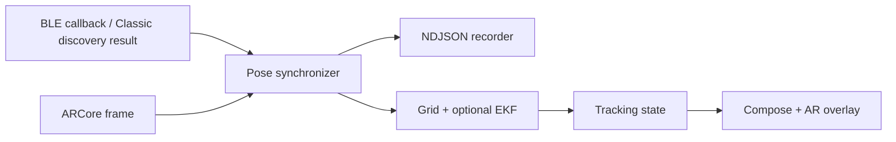

# AR Signal Locator

[](https://github.com/jakob1379/find-with-ar/actions/workflows/check.yml)

Android proof of concept for locating a stationary Bluetooth device by combining RSSI observations with ARCore phone poses. It supports BLE advertisements and discoverable Bluetooth Classic devices. The app ships as **AR Device Finder**.

<p align="center">
  
</p>

The app is intentionally honest about the available evidence. Early observations are shown as a probability region; a single direction or covariance ellipse is shown only after the data supports one dominant location.

## How it works

Each accepted RSSI reading is attached to the nearest recent ARCore camera pose and fed to a pure Kotlin localization engine.



| State | What it means |
| --- | --- |
| `SIGNAL_FOUND` | Radio readings exist, but there is not enough spatial diversity to infer a region. |
| `COLLECTING` | The grid posterior updates and shows one or more likely regions. |
| `LOCATED` | One dominant region and adequate path geometry; EKF refinement is optional. |
| `LOST_SIGNAL` / `TRACKING_LOST` | Measurements pause and confidence is not allowed to shrink. |

Details: [`docs/architecture.md`](docs/architecture.md).

## Scope

- Android, Kotlin, Jetpack Compose and ARCore
- Foreground BLE scanning followed by Bluetooth Classic discovery
- Anchor-relative 2D localization with height hypotheses
- Bayesian grid acquisition and optional EKF refinement
- Offline, versioned trace capture and deterministic replay
- Python/uv simulation and calibration utilities

Exported traces never contain a Bluetooth address, only a session-local label such as `D01`. Captures stay on the device unless you export them.

### Limits

It cannot find a device that is powered off, asleep or radio-blocked. BLE targets must advertise. Bluetooth Classic targets must remain discoverable (normally pairing mode); Android does not expose RSSI for an arbitrary paired or connected, non-discoverable Classic device.

## Development

```bash
nix develop
just bootstrap-wrapper   # needed only if the wrapper JAR was not retained
just check
just install
```

Use a physical ARCore-supported phone for combined Bluetooth and AR validation. The emulator is useful for UI and lifecycle tests but cannot reproduce indoor radio propagation.

Generate and inspect a deterministic synthetic trace with:

```bash
uv run --project analysis ar-signal-simulate /tmp/synthetic.ndjson --seed 7
uv run --project analysis ar-signal-replay /tmp/synthetic.ndjson --output /tmp/inputs.ndjson
uv run --project analysis ar-signal-analyse /tmp/synthetic.ndjson
```

## Documentation

| Document | Covers |
| --- | --- |
| [`SPEC.md`](SPEC.md) | v1 product and publishing specification |
| [`docs/architecture.md`](docs/architecture.md) | Runtime architecture, module boundaries, estimator states |
| [`docs/measurement-schema.md`](docs/measurement-schema.md) | Versioned NDJSON trace contract |
| [`docs/precision-experiments.md`](docs/precision-experiments.md) | Synthetic precision results |
| [`docs/IMPLEMENTATION_PLAN.md`](docs/IMPLEMENTATION_PLAN.md) | Staged gate evidence |
| [`docs/validation-protocol.md`](docs/validation-protocol.md) | Physical-phone procedure |

## Verification boundary

The debug APK, Android unit tests, Kotlin estimator tests, lint, Python tests and flake evaluation are verified in the build workspace. Simultaneous Bluetooth + ARCore behavior and real-room error/coverage remain physical-phone gates; no precision claim is treated as complete until labelled captures are replayed successfully.
