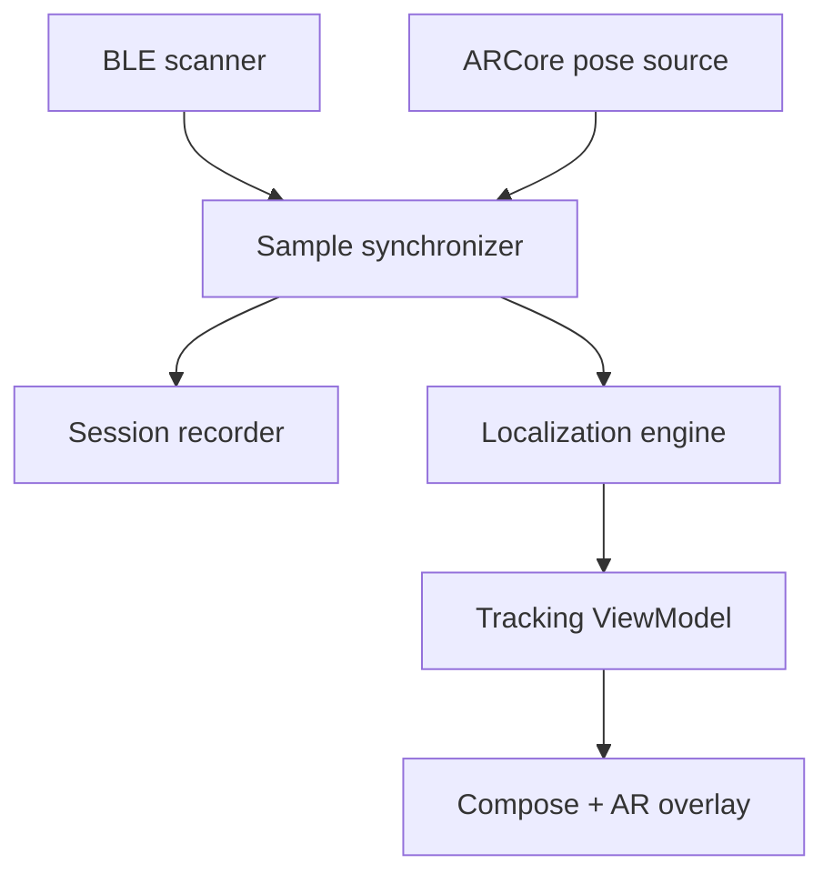

# AR Signal Locator — MVP implementation plan

Status: code-complete MVP candidate; physical-device validation remains open, 23 July 2026

## Implementation progress

This table is maintained during implementation. A phase is marked complete only after its stated gate has evidence; code written without physical-device evidence is recorded as implemented but not gate-complete.

| Phase | Status | Evidence / remaining gate |
| --- | --- | --- |
| 0 — Toolchain and hardware feasibility | **Implemented; gate open** | Pinned Nix flake, Gradle wrapper, dependency locks/verification metadata and CI are present; clean workspace builds pass. A fresh laptop build and concurrent physical BLE+AR trace remain required. |
| 1 — BLE discovery and target selection | **Implemented; gate open** | Foreground discovery/tracking, session-local identifiers, metadata, RSSI summaries, timeouts and permission policy compile and pass unit tests. The beacon plus two-consumer-device gate requires a phone. |
| 2 — AR pose capture, synchronization and replay | **Implemented; gate open** | ARCore floor-anchor poses, elapsed-time association, robust bucketing, schema-v1 recording/export and canonical replay are implemented and tested. A marked 30-second walk and the 95% valid-pose gate require a phone. |
| 3 — Simulator and estimator | **Complete (synthetic gate)** | Eleven deterministic Kotlin tests cover grid/EKF/hybrid behavior, analytic Jacobian, PSD covariance, stationary duplicates, HPD coverage, baseline improvement, replay and reset after inconsistent measurements. |
| 4 — Real calibration and model selection | **Tooling ready; gate open** | Python simulation, strict trace validation, baseline/error/coverage metrics and calibration gates pass 21 tests. Labelled room captures and held-out results have not been collected. |
| 5 — Tracking UX and AR overlay | **Implemented; gate open** | Compose discovery/tracking/debug states and camera-projected heat/ellipse overlay build and pass projection/state tests. First-time-user validation requires a phone. |
| 6 — MVP hardening | **Partially complete** | Lifecycle cancellation, recoverable permission/Bluetooth/AR states, signal-loss reset, local export/delete and backup exclusion are implemented. Ten-minute thermal, repeated physical start/stop and signed internal-release checks remain. |

### Current implementation checklist

- [x] Reproducible Nix/Gradle skeleton
- [x] Pure Kotlin localization module and deterministic tests
- [x] Android BLE scanner and permission flow
- [x] ARCore pose source and BLE/pose synchronization
- [x] Versioned local trace recording, export and deterministic replay
- [x] Compose device picker, tracking/debug UI and AR camera overlay
- [x] Python simulator, replay and calibration report
- [x] Static/in-container verification
- [ ] Fresh Nix build on the development laptop
- [ ] Physical-phone BLE + AR feasibility trace

### Verification evidence — 23 July 2026

- `nix flake check --no-build` evaluated the pinned flake in the prepared workspace. This does not replace the fresh-clone laptop gate.
- A clean Gradle run completed `:localization:test`, `:app:testDebugUnitTest`, `:app:lintDebug` and `:app:assembleDebug`: 21 tests, zero failures/errors, zero lint errors and five non-blocking warnings.
- The debug APK is 12,635,270 bytes with SHA-256 `1962acfd4cdf1aa70de0568ff95ae083fe00101701e0ad1948884cfcb3aca3ed`.
- Python 3.12 lock validation and Ruff passed; Pytest reports 21 passing tests. Canonical replay of the cross-language Android fixture has SHA-256 `2af5050d1752c929c451c6f24b9a7e1223fd560757b2a6ec1dd9667daf3d4f5c`.
- The Gradle 9.4.1 wrapper JAR matches its pinned SHA-256; Maven verification metadata and dependency lock files are committed.
- Export tests verify that a Bluetooth hardware address used for in-session selection is not serialized. Android backup and device-transfer extraction are disabled.
- No physical phone, beacon or labelled room was available in this environment. All rows that depend on radio propagation, ARCore tracking, usability, thermal behavior or held-out calibration remain explicitly open.

## 1. MVP outcome

Build an Android application that finds a **stationary, actively advertising BLE device within one room**. The user selects a device, walks around with the camera open, and receives:

- an AR indication of the most likely ground-projected location;
- an uncertainty region rather than a falsely precise arrow;
- guidance when more spatially diverse measurements are needed;
- a raw signal/proximity view when there is not yet enough evidence to localize.

The MVP is successful if it demonstrates that combining BLE RSSI with ARCore camera poses identifies the correct part of a room more reliably than an ordinary warmer/colder RSSI meter.

### Explicitly out of scope

- Wi-Fi, Bluetooth Classic, arbitrary radio signals, UWB and background scanning;
- devices that are asleep, inside a radio-blocking case, or not advertising;
- crowd-sourced finding outside Bluetooth range;
- moving targets, multi-room navigation and iOS;
- accounts, cloud services, maps or a backend.

Keeping this boundary is important: BLE + AR localization is the experiment. Everything else can wait until it is shown to work.

## 2. Core decisions

| Area | MVP decision | Reason |
| --- | --- | --- |
| Platform | Native Android, Kotlin | Best access to BLE scan timestamps, ARCore and low-level diagnostics |
| UI | Jetpack Compose around an ARCore rendering surface | Simple state-driven UI without adopting a large 3D engine |
| Radio | BLE advertisements only | Continuously observable RSSI on commodity phones |
| Spatial model | 2D horizontal `x/z` position relative to an ARCore floor anchor, marginalizing several target-height hypotheses | The useful answer is normally an area on the floor plan; height is weakly observable |
| Estimator | Bayesian grid acquisition, then a validated EKF refinement | Represents early multimodality, then optionally provides fast recursive mean and covariance updates |
| Persistence | Local versioned JSONL/CSV capture files | Enables deterministic replay and Python analysis before choosing model constants |
| Backend | None | Finding must work offline and the measurements are sensitive location-adjacent data |
| Test hardware | A physical ARCore-supported Android phone plus a controllable BLE beacon | Emulators cannot reproduce the real BLE/indoor-multipath problem |

## 3. Why not use only a conventional Kalman filter?

The Kalman idea is useful, but the first measurements do not form a Gaussian position estimate. One RSSI observation approximately describes a broad ring around the phone. Several early observations can produce multiple plausible regions. An ordinary Kalman filter represents only one mean and covariance, so it can become confidently attached to the wrong mode.

The proposed hybrid keeps the desirable recursive update:

1. **Collecting phase:** maintain a coarse probability grid while the user establishes a useful baseline. Marginalize plausible target heights, transmit powers and path-loss exponents.
2. **Initialization:** select the dominant mode only when the phone positions have sufficient spatial diversity.
3. **Tracking phase:** initialize an extended Kalman filter (EKF) from that mode and update the location mean and covariance recursively.
4. **Fallback:** if innovation statistics become inconsistent or another mode remains material, return to the grid/collecting state rather than displaying false confidence.

The grid is already a recursive Bayesian filter and directly supplies a heatmap and credible area. The EKF is an optimization, not a foregone conclusion: it stays only if held-out recordings show equal or better error and uncertainty calibration.

The EKF state is initially:

$$
\mathbf{x} = [s_x, s_z, A, n]^T
$$

where $(s_x,s_z)$ is the target's horizontal position, $A$ is expected RSSI at 1 metre, and $n$ is the environmental path-loss exponent. For phone position $\mathbf{p}_k=(p_{x,k},p_{z,k})$, the observation model is:

$$
z_k = A - 10n\log_{10}\left(\max(d_k,d_{\min}) / 1\text{ m}\right) + v_k
$$

$$
d_k = \sqrt{(s_x-p_{x,k})^2 + (s_z-p_{z,k})^2}
$$

The transition is approximately identity because the target is assumed stationary. Position gets very small process noise; $A$ and $n$ get slightly more so that the model can adapt to orientation and environmental changes.

During acquisition, display a highest-posterior-density (HPD) region from the grid and report its cell-count area. Do not display the posterior mean when it falls between two likely regions. Once one connected component contains most of the posterior mass—for example, more than 80%—the position block $P_{xz}$ of an initialized EKF can produce an ellipse. For confidence level $c$, the ellipse is:

$$
(\mathbf{s}-\hat{\mathbf{s}})^T P_{xz}^{-1}(\mathbf{s}-\hat{\mathbf{s}}) \leq \chi^2_{2,c}
$$

and its area is:

$$
\text{area}_c = \pi\chi^2_{2,c}\sqrt{\det(P_{xz})}.
$$

This area is only labelled as a calibrated confidence region after real-world coverage tests confirm that, for example, nominal 80% regions contain the known target approximately 80% of the time.

## 4. Runtime architecture



### Important interfaces

```kotlin
data class BleObservation(
    val observedAtElapsedNanos: Long,
    val receivedAtElapsedNanos: Long,
    val deviceKey: DeviceKey,
    val rssiDbm: Int,
    val txPowerDbm: Int?,
)

data class PoseObservation(
    val capturedAtElapsedNanos: Long,
    val positionMetres: Vec3,
    val rotation: Quaternion,
    val trackingState: TrackingState,
)

data class LocatedObservation(
    val phonePose: PoseObservation,
    val rssiDbm: Double,
    val rssiVariance: Double,
)

data class LocationEstimate(
    val meanXZ: Vec2?,
    val covarianceXZ: Matrix2?,
    val credibleAreaSquareMetres: Double?,
    val state: EstimateState,
    val dataQuality: DataQuality,
)
```

`ScanResult.getTimestampNanos()` is time-since-boot, while ARCore explicitly leaves the time base of `Frame.getTimestamp()` undefined. Do not assume they are directly interchangeable. Timestamp both callbacks with `SystemClock.elapsedRealtimeNanos()`, retain the platform timestamps for diagnostics, and associate each BLE observation with the nearest recently processed AR pose. Quantify callback latency during the capture milestone. Keep poses and estimates relative to a floor anchor so that ARCore world-coordinate adjustments do not invalidate the session.

### Suggested project layout

```text
.
├── flake.nix
├── flake.lock
├── .envrc
├── nix/
│   ├── android-sdk.nix
│   └── dev-shell.nix
├── app/                       # Android integration and UI
├── localization/              # Pure Kotlin estimator and replay API
├── analysis/
│   ├── pyproject.toml         # uv-managed Python 3.12 analysis tools
│   ├── src/
│   └── tests/
├── test-data/
│   ├── synthetic/
│   └── fixtures/              # Sanitized short captured sessions
├── docs/
│   ├── architecture.md
│   ├── measurement-schema.md
│   └── validation-protocol.md
├── gradle/libs.versions.toml
├── gradle/wrapper/
└── settings.gradle.kts
```

Use only two Gradle modules initially: `:app` and a platform-independent `:localization`. Additional modules would add ceremony before any complexity justifies them.

## 5. Nix development environment

### Pinned inputs and packages

- Pin `nixpkgs` and `flake-utils` in `flake.lock`.
- Compose the Android SDK with `pkgs.androidenv.composeAndroidPackages`.
- Pin Android API 37, Build Tools 36.0.0 and matching platform tools.
- Start with Android Gradle Plugin 9.2.1, Gradle wrapper 9.4.1 and JDK 17. This supports API 37 while remaining compatible with the stable Android Studio currently packaged by the pinned Nixpkgs input. AGP 9.3/Gradle 9.5 adds no MVP capability and can wait for the IDE package to catch up.
- Pin Kotlin/Compose compiler plugin 2.3.10 and Compose BOM 2026.06.00. AGP 9 uses built-in Kotlin, so do not also apply `org.jetbrains.kotlin.android`.
- Include `adb`, `uv`, Python 3.12, `just`, `jq`, Git and common Android native runtime libraries.
- Do **not** include the NDK initially; this Kotlin/ARCore MVP does not compile native code.
- Keep Android Studio and emulator images in an optional `ide`/`emulator` shell so the default environment remains smaller.

| Component | Initial pin |
| --- | --- |
| Host | `x86_64-linux` |
| JDK | 17 |
| Android Gradle Plugin | 9.2.1 |
| Gradle wrapper | 9.4.1 |
| `compileSdk` / `targetSdk` | 37 |
| `minSdk` | 24 |
| SDK Build Tools | 36.0.0 |
| Kotlin / Compose compiler | 2.3.10 |
| Compose BOM | 2026.06.00 |
| NDK / CMake | omitted |

Compose the default shell with `platformVersions = [ "37" ]`, `buildToolsVersions = [ "36.0.0" ]`, `includeNDK = false` and `includeCmake = false`. The optional IDE shell additionally enables the emulator, a Google APIs x86-64 system image and `pkgs.android-studio.withSdk`. “Latest” command-line/platform-tool versions remain fixed by the committed Nixpkgs revision.

The flake should set:

- `ANDROID_HOME` and `ANDROID_SDK_ROOT` to the composed SDK;
- `JAVA_HOME` to the pinned JDK;
- `GRADLE_OPTS` with `android.aapt2FromMavenOverride` pointing at the Nix-provided `aapt2`, avoiding an incompatible Maven-downloaded binary on NixOS;
- Android SDK licence acceptance through the Nixpkgs configuration.

The Gradle wrapper remains the canonical Gradle version. Commit all wrapper files and `distributionSha256Sum`, dependency verification metadata, version catalogues and dependency locks. The Nix shell makes the SDK/JDK/tooling reproducible; Gradle dependency pinning handles the Maven half of the build. A fully Nix-pure Gradle build is deliberately deferred until it provides value.

### Required developer commands

```bash
nix develop
./gradlew testDebugUnitTest lintDebug assembleDebug
uv sync --locked --project analysis
uv run --project analysis pytest
adb devices
adb install -r app/build/outputs/apk/debug/app-debug.apk
```

Wrap these in `just check`, `just install`, `just capture` and `just analyse` after the raw commands work.

### Environment acceptance gate

- A fresh clone plus `nix develop` can build the debug APK.
- `./gradlew testDebugUnitTest lintDebug assembleDebug` passes.
- `uv run --project analysis pytest` passes.
- `adb` detects the physical test phone and installs the APK.
- CI runs the same headless commands from the flake.

The emulator is useful for Compose/UI tests but is not an acceptance environment for combined AR + BLE localization. Make the app **AR Required** with `minSdk = 24`, `compileSdk = 37` and `targetSdk = 37`; runtime availability/install checks are still required. On NixOS, give the development user KVM access for the emulator and enable ADB USB access where the system version does not provide automatic `uaccess`. The SDK is immutable in `/nix/store`: missing components are added declaratively to the flake, never installed by Android Studio. Google supplies Linux Android tooling primarily for x86-64, so an ARM Linux workstation would need a separate decision rather than pretending the same shell is portable.

## 6. Phased implementation

### Phase 0 — Toolchain and hardware feasibility spike (1–2 days)

Deliverables:

- flake, lock file, Gradle wrapper and version catalogue;
- minimal Compose application;
- pure Kotlin `:localization` module;
- Python/uv analysis project;
- CI running Nix-based lint, Kotlin unit tests and Python tests.

Before estimator work, verify on the physical target phone that the app can run ARCore tracking and a foreground BLE scan simultaneously. Record a 30-second `(time, pose, RSSI)` trace for a controllable beacon and for the headphones/devices we actually want to find, including the behaviour inside their charging case.

Gate: all environment acceptance checks above pass on a fresh clone, and at least one relevant target emits repeated advertisements throughout a walking session while ARCore remains in `TRACKING` state.

### Phase 1 — BLE discovery and target selection (1–2 days)

Implement a foreground `BleScanner` using `BluetoothLeScanner` and expose observations as a cold `Flow`/`callbackFlow`. Discovery is time-limited; after selection use `SCAN_MODE_LOW_LATENCY` only while the find screen is visible. The scan screen displays:

- advertised name when available;
- session-local identifier;
- manufacturer/service identifiers;
- live and short-window median RSSI;
- last-seen age and advertising frequency.

Permissions:

- `BLUETOOTH_SCAN`;
- `BLUETOOTH_CONNECT` only where paired-device metadata requires it;
- `ACCESS_FINE_LOCATION`, because this app explicitly derives physical location from scan results and therefore must not claim `neverForLocation`;
- runtime permission rationale in plain language.

Do not promise support for every paired headphone. A device is selectable only while the app actually observes suitable advertisements.

Gate: select and continuously observe a dedicated test beacon and at least two real consumer devices, with correct signal-loss/timeout behaviour.

### Phase 2 — AR pose capture, synchronization and replay (1–3 days)

Implement an ARCore session and stream camera pose only while tracking state is valid. Join BLE readings to recent poses, aggregate highly correlated readings, and write a versioned session log containing:

- both platform and app monotonic timestamps;
- raw RSSI, advertised Tx power and identifying advertisement fields;
- AR position, orientation and tracking state;
- phone/device model and app/schema versions;
- estimator inputs and outputs.

Initial aggregation rule: a robust median/MAD window, followed by at most one estimator update per small spatial/time bucket. Repeated readings at the same position may refine signal noise, but must not create the illusion of new spatial information.

Gate: walk a marked path, export/replay it, and reproduce an identical ordered estimator input stream. At least 95% of accepted BLE samples must have a valid, sufficiently recent pose.

### Phase 3 — Synthetic simulator and estimator baseline (2–4 days)

Build the localization logic outside Android first:

1. deterministic log-distance simulator with adjustable target position, $A$, $n$, Gaussian noise, outliers and wall/body attenuation;
2. coarse grid acquisition filter with a robust Student-t likelihood, initially around 0.25 m horizontal cells over a 10–12 m room, several target-height hypotheses, broad $A$ hypotheses and $n\approx1.5\ldots4$;
3. EKF using $[s_x,s_z,A,n]$ and analytic Jacobian;
4. grid marginalization to 2D 50%/90% HPD regions, plus normalized-innovation-squared gating and covariance inflation for the optional EKF;
5. path-geometry score based on displacement and conditioning/spatial spread;
6. a plain strongest-RSSI/warmer-colder baseline.

Unit/property tests:

- Jacobian agrees with numerical differentiation;
- covariance remains symmetric positive semidefinite;
- uncertainty does not collapse from duplicated stationary samples;
- convergence occurs from multiple seeds once the path is informative;
- an inconsistent/moving target causes low-confidence/reset rather than a precise answer;
- replay is deterministic.

Gate: on seeded synthetic scenarios, the hybrid estimator beats strongest-RSSI on median error and its nominal uncertainty regions have approximately correct coverage.

### Phase 4 — Real data calibration and model selection (2–4 days)

Collect labelled sessions using a fixed beacon at measured coordinates:

- open room and cluttered furnished room;
- line-of-sight, behind furniture and body-occluded cases;
- target on floor, table and shelf;
- at least three walking trajectories per target position;
- multiple phone orientations and, if available, a second Android handset.

Analyse in Python and compare:

- raw strongest-RSSI point;
- robust grid posterior alone;
- grid-initialized EKF;
- particle filter only if the EKF is materially miscalibrated or frequently chooses the wrong mode.

Tune only on training sessions; keep entire rooms/positions as held-out validation sets. Store sanitized fixtures, not stable hardware addresses.

Initial go/no-go targets after roughly 20–30 seconds and at least 3 metres of useful movement:

- open room median horizontal error no worse than 1.5 m;
- furnished room median error no worse than 2.5 m;
- held-out 90th-percentile horizontal error no worse than 3 m for the defined same-room benchmark;
- clear improvement over strongest-RSSI baseline;
- nominal 80% region has 70–90% empirical held-out coverage;
- no high-confidence result when path geometry is insufficient;
- time-to-first-useful-region below 15 seconds for a beacon advertising at least once per second.

If the estimator cannot beat the baseline consistently, stop AR UI work and revisit the observation model. That is the central technical gate.

### Phase 5 — Tracking UX and AR overlay (2–4 days)

Implement three honest UI states:

1. **Signal found:** raw warmer/colder meter; not enough movement yet.
2. **Collecting:** breadcrumbs/mini-map plus a short instruction such as “move sideways” or “walk around the other side.”
3. **Located:** most likely region and confidence/area, with the target marker only when quality thresholds pass.

Render the horizontal estimate and ellipse using ARCore view/projection matrices and a lightweight drawing layer. Avoid introducing a full scene engine unless projection/occlusion work proves more expensive than the dependency.

If the posterior is still multimodal, display a heat region or continue collecting—never collapse it to a single arrow for visual neatness.

Gate: a first-time user can select a visible beacon and complete a search without technical terminology, while the diagnostic screen still exposes raw RSSI, sample count, path baseline, residuals and covariance for development.

### Phase 6 — MVP hardening (1–3 days)

- lifecycle-safe start/stop for camera and scanner;
- lost-signal, Bluetooth-off, permission-denied and AR-tracking-loss states;
- thermal/battery profiling during a 10-minute session;
- crash-free repeated start/stop tests;
- privacy text and local-data deletion/export;
- signed internal APK and concise test protocol.

## 7. Quality and observability rules

The app should log and expose these metrics per session:

- accepted/rejected observations and rejection reasons;
- advertisement interval and RSSI rolling median/MAD;
- distance travelled and spatial spread of phone poses;
- grid mode ratio or ambiguity score;
- EKF innovation, normalized innovation squared and residual variance;
- covariance eigenvalues and displayed ellipse area;
- estimate error when ground truth is supplied in benchmark mode;
- AR tracking losses and BLE-to-pose association age.

Confidence must depend on residual fit **and** observation geometry. A small covariance alone is not enough.

## 8. Main risks and mitigations

| Risk | Consequence | Mitigation / decision gate |
| --- | --- | --- |
| RSSI multipath and body shadowing | Biased or jumping estimates | Robust aggregation, adaptive noise, innovation gating, real-room calibration |
| Unknown Tx power and path-loss exponent | Distance/location ambiguity | Estimate $A$ and $n$, use broad priors, require spatially diverse path |
| Early posterior is multimodal | EKF locks onto wrong location | Grid initializer and explicit collecting state |
| Repeated correlated packets | False covariance shrinkage | Spatial/time bucketing and measurement-noise floor |
| AR drift or tracking loss | Samples get wrong coordinates | Reject invalid tracking, monitor resets, keep sessions short |
| BLE identity rotation | Selected target disappears or changes identity | Use service/manufacturer payload fingerprint where possible; document session-local limitation |
| Headphones stop advertising | Device cannot be found | Detect and explain; validate supported-device behaviour before marketing claims |
| Device actually moves | Stationary model becomes invalid | Innovation test and reset/“target may be moving” state |
| Confidence is numerically precise but wrong | Misleading product | Held-out coverage calibration is a release gate |

## 9. Definition of MVP done

The MVP is done when:

- a fresh Nix environment builds and tests the application;
- the app finds and selects actively advertising BLE devices;
- every estimator input can be captured, exported and deterministically replayed;
- the estimator produces a location region plus uncertainty from AR-tagged measurements;
- held-out physical experiments show improvement over a normal RSSI meter;
- the UI withholds or broadens results when evidence is weak;
- all operation is foreground-only and local to the phone;
- limitations are explicit: BLE advertising, stationary target, nearby/single-room search.

## 10. Follow-on backlog, only after the MVP gate

1. 2.5D target-height hypotheses and AR occlusion/depth.
2. Active next-best-view guidance using expected information gain.
3. Per-phone/per-device calibration profiles.
4. Support for connected BLE devices and carefully scoped Bluetooth Classic experiments.
5. UWB adapters for genuine range/direction on compatible hardware.
6. iOS BLE parity; do not plan cross-platform Wi-Fi scanning because iOS lacks a general-purpose API.
7. Optional Wi-Fi access-point mode on Android, recognising platform scan throttling.

## Primary references

- [Android BLE overview](https://developer.android.com/develop/connectivity/bluetooth/ble/ble-overview)
- [Android Bluetooth permissions](https://developer.android.com/develop/connectivity/bluetooth/bt-permissions)
- [Android `ScanResult` timestamp and RSSI API](https://developer.android.com/reference/android/bluetooth/le/ScanResult)
- [ARCore session configuration](https://developers.google.com/ar/develop/java/session-config)
- [ARCore `Frame` timestamp and camera-pose API](https://developers.google.com/ar/reference/java/com/google/ar/core/Frame)
- [Enable ARCore in an Android application](https://developers.google.com/ar/develop/java/enable-arcore)
- [Android Java/JDK build guidance](https://developer.android.com/build/jdks)
- [Android Gradle Plugin 9.2 compatibility](https://developer.android.com/build/releases/agp-9-2-0-release-notes)
- [Android built-in Kotlin migration](https://developer.android.com/build/migrate-to-built-in-kotlin)
- [Gradle wrapper verification](https://docs.gradle.org/current/userguide/gradle_wrapper.html)
- [Gradle dependency locking](https://docs.gradle.org/current/userguide/dependency_locking.html)
- [Nixpkgs Android package composition source](https://github.com/NixOS/nixpkgs/blob/master/pkgs/development/mobile/androidenv/compose-android-packages.nix)
- [Nixpkgs Android documentation](https://github.com/NixOS/nixpkgs/blob/master/doc/languages-frameworks/android.section.md)
- [ARCore `Pose` and coordinate guidance](https://developers.google.com/ar/reference/java/com/google/ar/core/Pose)
- [Bluetooth indoor-localization survey](https://arxiv.org/abs/2404.12529)
- [Design and implementation of an RSSI-based BLE indoor-localization system](https://arxiv.org/abs/2310.14704)
