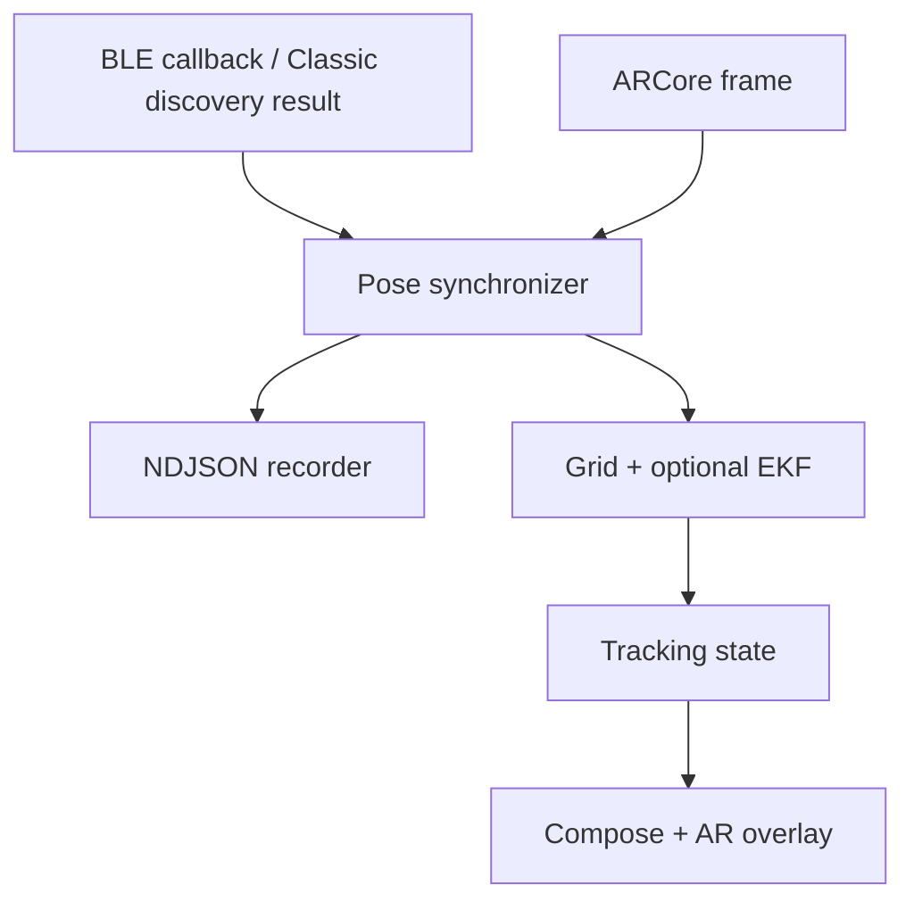

# Runtime architecture

The application is foreground-only. It observes BLE advertisements or Bluetooth Classic inquiry results, attaches each accepted RSSI measurement to the nearest recent ARCore camera pose, and feeds the resulting spatial observation to the pure Kotlin localization engine.

## Boundaries

- `:app` owns Android permissions, Bluetooth scanning, ARCore lifecycle, callback timing, trace export and UI state.
- `:app` also owns monetization: `BillingEntitlementController` publishes Play Billing entitlement,
  `AdsConsentController` publishes consent and SDK readiness, and `MainActivity` combines those
  states with build-variant policy. The Compose shell uses the resulting ad eligibility and routes
  Complete Scan either to the runtime or the Pro purchase sheet.
- `:localization` is Android-free Kotlin. It owns robust aggregation, the Bayesian grid posterior, HPD regions, path-geometry checks, EKF refinement and deterministic simulation.
- `analysis` reads the same versioned NDJSON trace contract. It computes the strongest-RSSI baseline, estimate error and uncertainty coverage without depending on Android.

All timestamps used for callback association come from `SystemClock.elapsedRealtimeNanos()`. BLE and ARCore platform timestamps are retained only as diagnostics because their documented time bases are not guaranteed to match. Classic discovery has no per-result platform timestamp, so its callback timestamp is recorded in both timestamp fields.

## Estimator state transitions

1. `SIGNAL_FOUND`: radio readings exist, but there is not enough spatial diversity to infer a region.
2. `COLLECTING`: the grid posterior updates recursively and exposes one or more HPD components.
3. `LOCATED`: a dominant component and adequate path geometry allow a single location region. EKF refinement is optional and remains subject to innovation gating.
4. `LOST_SIGNAL` or `TRACKING_LOST`: measurements pause and confidence is not allowed to shrink.

Up to three readings from essentially the same phone position are robustly aggregated into one likelihood term. Their within-position scatter may refine measurement variance, but they do not count as independent geometry. A rolling RSSI window is retained for display only; changes while the phone moves are not misclassified as sensor noise.

## Privacy and identity

Device addresses are runtime-only selection keys. Exported traces contain only a short session-local label (`D01`, `D02`, …) plus observable Bluetooth metadata; they never persist a Bluetooth address. Captures stay on-device unless the user invokes export.
