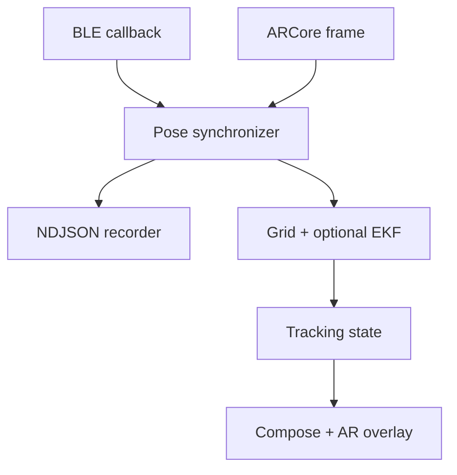

# Runtime architecture

The MVP is a foreground-only Android application. It observes BLE advertisements, attaches each accepted RSSI measurement to the nearest recent ARCore camera pose, and feeds the resulting spatial observation to the pure Kotlin localization engine.

## Boundaries

- `:app` owns Android permissions, BLE scanning, ARCore lifecycle, callback timing, trace export and UI state.
- `:localization` is Android-free Kotlin. It owns robust aggregation, the Bayesian grid posterior, HPD regions, path-geometry checks, EKF refinement and deterministic simulation.
- `analysis` reads the same versioned NDJSON trace contract. It computes the strongest-RSSI baseline, estimate error and uncertainty coverage without depending on Android.

All timestamps used for callback association come from `SystemClock.elapsedRealtimeNanos()`. BLE and ARCore platform timestamps are retained only as diagnostics because their documented time bases are not guaranteed to match.

## Estimator state transitions

1. `SIGNAL_FOUND`: advertisements exist, but there is not enough spatial diversity to infer a region.
2. `COLLECTING`: the grid posterior updates recursively and exposes one or more HPD components.
3. `LOCATED`: a dominant component and adequate path geometry allow a single location region. EKF refinement is optional and remains subject to innovation gating.
4. `LOST_SIGNAL` or `TRACKING_LOST`: measurements pause and confidence is not allowed to shrink.

Repeated packets from essentially the same phone position are aggregated before estimator updates. They may refine signal variance, but do not count as independent geometry.

## Privacy and identity

Device addresses are runtime-only selection keys. Exported traces contain only a short session-local label (`D01`, `D02`, …) plus observable advertisement metadata; they never persist a Bluetooth address. Captures stay on-device unless the user invokes export.
